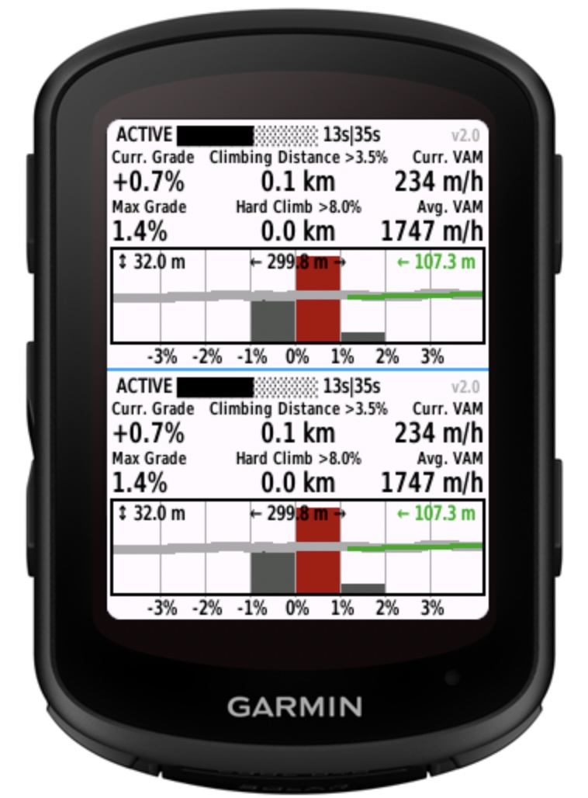
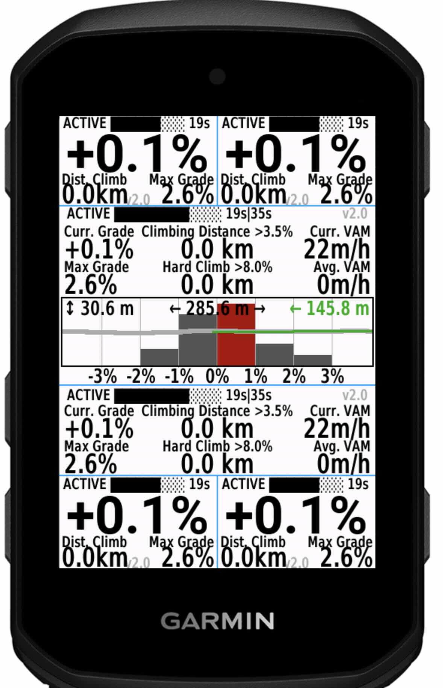
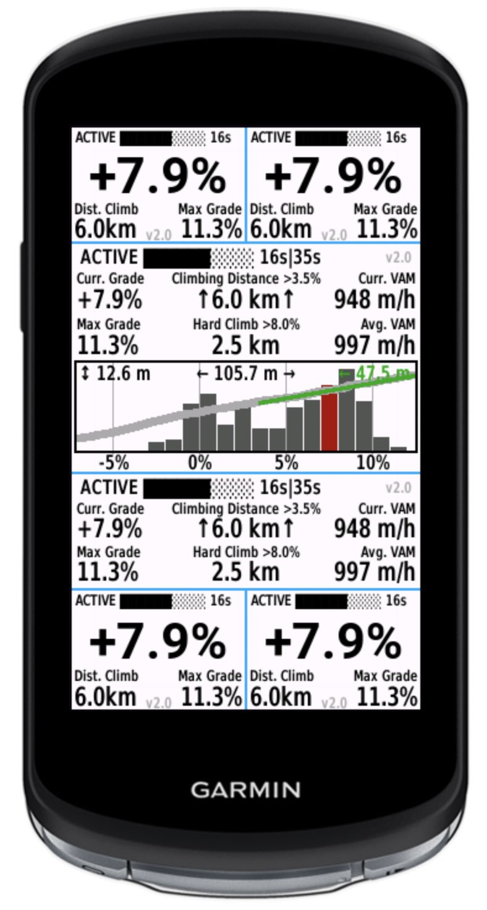
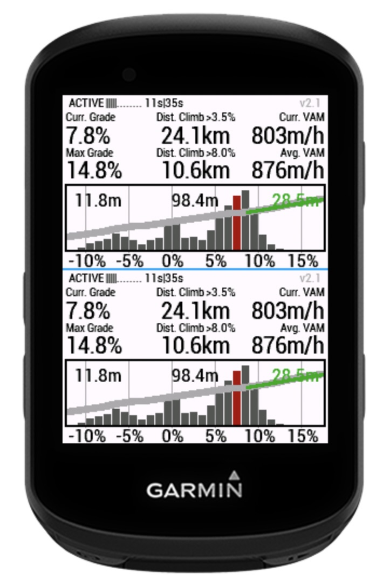

<div align="center">

# Adaptive Grade Plus

**Smooth, responsive slope estimation for Garmin Edge cycling computers.**

[](https://apps.garmin.com/en-US/apps/24827718-3484-48ab-977a-5e8055cbfbe2)

<!-- Connect IQ Store metadata verified 2026-07-16. -->
[](https://apps.garmin.com/en-US/apps/24827718-3484-48ab-977a-5e8055cbfbe2)
[](https://apps.garmin.com/en-US/apps/24827718-3484-48ab-977a-5e8055cbfbe2)
[](https://apps.garmin.com/en-US/apps/24827718-3484-48ab-977a-5e8055cbfbe2)
[](https://apps.garmin.com/en-US/apps/24827718-3484-48ab-977a-5e8055cbfbe2)
[](https://developer.garmin.com/connect-iq/)

</div>

Adaptive Grade Plus is a Connect IQ data field that replaces jumpy, delayed grade readings with an estimate designed for real-world road cycling. It uses adaptive linear regression to smooth the reading on steady climbs while shortening its sampling window when the road pitches up or down.

## Highlights

- Responsive live grade estimation with an adaptive sampling window
- Current grade, climbing distance, current VAM, and average VAM
- Configurable thresholds for light and hard climbing
- Sustained-grade statistics for 10 seconds, 1 minute, and up to 30 minutes
- Altitude-profile and grade-distribution views on larger layouts
- Compact, full, and simplified grade-focused layouts
- Optional FIT recording for Garmin Connect activity analysis
- Metric and imperial units, light and dark backgrounds
- English, German, French, and Spanish translations

## Install

1. Open [Adaptive Grade Plus in the Garmin Connect IQ Store](https://apps.garmin.com/en-US/apps/24827718-3484-48ab-977a-5e8055cbfbe2) on your phone.
2. Install the data field and sync your Garmin Edge.
3. Open the activity profile you use for cycling and edit its data screens.
4. Add a Connect IQ field and select **Adaptive Grade Plus**.
5. Start a ride. The field buffers a few samples before the grade becomes active.

The exact menu names vary slightly between Edge models and firmware versions.

## What it shows

| Metric | Description |
| --- | --- |
| Current grade | Adaptive regression estimate of the current slope |
| Climbing distance | Distance ridden above the configurable light and hard grade thresholds |
| VAM | Current and average vertical ascent rate |
| Sustained grade | Highest grade maintained for 10 seconds and longer time windows |
| Quality/status | Indicates buffering, active calculation, missing data, or FIT logging issues |
| Graphs | Recent altitude samples, grade distribution, or both |

On touch-capable, compatible layouts, tap the graph area to cycle through the available graph modes.

## Preview

<div align="center">
  
  
  
  
</div>

## FIT recording

Session summary recording is enabled by default. Adaptive Grade Plus can add the following information to the activity FIT file:

- Light and hard climbing distance totals
- Lap-average grade
- Maximum grade held for 10 seconds, 1 minute, and 30 minutes
- Continuous grade samples when **Log Gradient Data** is enabled

Continuous grade logging is disabled by default and can be enabled independently in the data field settings.

## Settings

The data field can be customized in Garmin Connect IQ:

- Choose a simplified large-grade display
- Select the secondary values shown in compact layouts
- Show the altitude buffer, histogram, or both
- Change the light and hard climbing thresholds (defaults: 3.5% and 8%)
- Tune the sample buffer and minimum/maximum regression window
- Adjust quality thresholds used for distance and maximum-grade statistics
- Enable or disable FIT summary and continuous grade recording

## Supported devices

- Edge 530, 540, and 550
- Edge 830, 840, and 850
- Edge 1030, 1030 Bontrager, and 1030 Plus
- Edge 1040 and 1050
- Edge Explore 2
- Edge MTB

The minimum supported Connect IQ API level is **3.3.0**. Check the store listing for the latest compatibility information.

## Development

The project is written in [Monkey C](https://developer.garmin.com/connect-iq/monkey-c/) and has no external barrel dependencies.

### Requirements

- Garmin Connect IQ SDK
- A Connect IQ developer key
- Visual Studio Code with the Monkey C extension, or the SDK command-line tools

### Build from the command line

```sh
git clone https://github.com/FrederikTheisen/FT_GradeEstimator.git
cd FT_GradeEstimator
monkeyc -f monkey.jungle \
  -d edge840 \
  -o AdaptiveGradePlus.prg \
  -y /path/to/developer_key
```

Replace `edge840` with another product ID from [`manifest.xml`](manifest.xml) when targeting a different supported device. You can also build and run the data field directly from the Monkey C extension in Visual Studio Code.

## Feedback and contributions

Bug reports, feature requests, and pull requests are welcome. Please use [GitHub Issues](https://github.com/FrederikTheisen/FT_GradeEstimator/issues) and include your Edge model, firmware version, and data field version when reporting a device-specific problem.

<!--
Partnumbers
// 530:     006-B3121-00 April 2019
// 830:     006-B3122-00 April 2019
// 1030:    006-B2713-00 late 2017
// 1030+:   006-B3570-00 June 2020
// 1030B:   006-B3095-00 Late 2018
// Exp2:    006-B4169-00 July 2022

// 540:     006-B4061-00 May 2023
// 840:     006-B4062-00 May 2023
// 1040:    006-B3843-00 June 2022

// 1050:    006-B4440-00 July 2024
// 850:     006-B4634-00
-->
